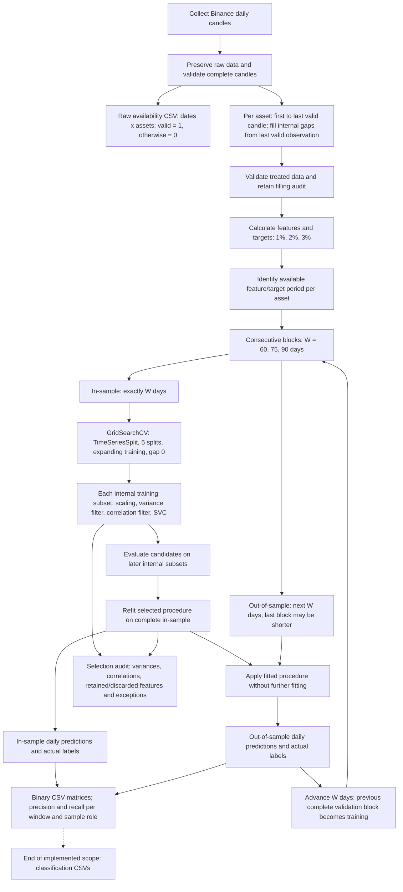

# Daily block-window experiment diagram

This diagram summarizes the [October 31 methodology revision](daily-block-window-experiment.md).
It describes the active classification implementation. All dates are UTC; the study calendar is 2019-07-01 to 2026-09-01.

For W = 60, the outer blocks are:

| Fit | In-sample | Out-of-sample |
| --- | --- | --- |
| 1 | Days 1-60 | Days 61-120 |
| 2 | Days 61-120 | Days 121-180 |
| 3 | Days 121-180 | Days 181-240, or the available terminal subset |

Day numbers refer to the available modeling calendar, not a common listing
date across all assets. There are no skipped days between outer blocks.
The outer out-of-sample never enters its own block's search or preprocessing fit.

Rows are dated by their features; targets refer to the following day. Training
uses known in-sample labels; validation labels are used only for later scoring.
Internal splits use the approved TimeSeriesSplit defaults documented in the
linked decision: five expanding training subsets and validation sizes of
10, 12 or 15 days for outer windows of 60, 75 or 90 days, respectively.
Target availability must be tested at each
fit; the formula and consecutive outer blocks remain unchanged.

The existing parameter grid, winner selection and single-class handling remain
unchanged. LUNAUSDT remains excluded from modeling and included in raw quality
evidence. All tabular artifacts use CSV, grouped by execution under the
[artifact organization decision](csv-artifact-organization.md). The diagram
describes implemented behavior; historical results remain evidence of the previous protocol.
